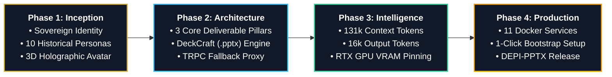

<p align="center">
  
</p>

<h1 align="center">TuT AI: Sovereign Local AI Platform</h1>

<p align="center">
  <b>100% Offline Sovereign Intelligence Workspace Engineered for the Ministry of Communications and Information Technology (MCIT).</b><br/>
  Deep Document Summarization, Autonomous PowerPoint Generation, Vector Infographics, and 3D Holographic Cartouche on Local Egyptian Hardware.
</p>

<p align="center">
  <a href="https://github.com/MCIT-DEPI/DEPI-PPTX"></a>
  
  
  
</p>

<p align="center">
  <a href="#-executive-summary">Overview</a> •
  <a href="#-project-leadership--governance">Leadership & Team</a> •
  <a href="#-live-platform--agent-showcase">Live Showcase</a> •
  <a href="#-the-three-core-powerhouses">Core Pillars</a> •
  <a href="#️-the-development-journey">Development Journey</a> •
  <a href="#-system-architecture">Architecture</a> •
  <a href="#-quick-start--turnkey-deployment">Quick Start</a> •
  <a href="#-official-pitch-deck-deliverables">Pitch Decks</a>
</p>

---

> [!IMPORTANT]
> **Complete Data Sovereignty Guaranteed:** All vector indexing, database storage, document compilation, and large language model inference run 100% locally on on-premise Egyptian infrastructure. Zero data packets ever leave the state firewall.

---

## 🏛️ Executive Summary

**TuT AI** is Egypt's sovereign enterprise AI platform, purpose-built for the **Ministry of Communications and Information Technology (MCIT)** under the Digital Egypt Pioneers Initiative (DEPI). Designed from first principles to operate with zero commercial cloud dependency, TuT AI guarantees absolute data privacy, full immunity against foreign SaaS disruptions, and uncapped on-premise processing speed.

### Core Deliverables at a Glance:
- **📑 Pillar 1 — Intelligent Deep Summarization:** Ingests massive ministerial decrees, legal codes, and 100+ page reports into structured executive digests backed by verifiable, numbered passage citations `[1]`, `[2]`.
- **📊 Pillar 2 — Autonomous PowerPoint Engine (DeckCraft):** In-chat natural language prompting generates complete, fully editable `.pptx` presentations styled with MCIT typography, royal gold framing, and automated layout auditing.
- **🎨 Pillar 3 — VectorCraft Infographics Studio:** Automatically translates statistical metrics and policy timelines into clear visual sketchnotes, scalable vector art (`.svg`), and print-ready vector PDFs.

---

## 👥 Project Leadership & Governance

Under the auspices and strategic supervision of the **Ministry of Communications and Information Technology (MCIT)**:

### 🎖️ Ministry Supervision & Strategic Guidance
| Leader | Role & Responsibility | Institutional Affiliation |
|---|---|---|
| **Dr. Mohamed Rehan** | **Ministry Leadership & Academic Oversight** | Ministry of Communications and Information Technology (MCIT) |
| **Eng. Reham Metwally** | **Ministry Leadership & Technical Guidance** | Ministry of Communications and Information Technology (MCIT) |
| **Eng. Mohamed Khalid Mohamed Roshdy** | **Ministry Leadership & Strategic Direction** | Ministry of Communications and Information Technology (MCIT) |

### ⭐ TuT AI Core Engineering Team
| Engineer | Role & Contribution | Status |
|---|---|---|
| **⭐ Ahmed Gamal Sophi Arfa** | **Project Lead & Principal System Architect** | ⭐ **Lead** |
| **Abdelrhman Mahmoud Fawzy** | Core Engineering Team | Member |
| **Saja Raafat Gaber** | Core Engineering Team | Member |
| **Mohamed Hamdy Abdelazez** | Core Engineering Team | Member |
| **Asmaa Samy Hagag** | Core Engineering Team | Member |
| **Mohamed Abd elhgani el kwatihy** | Core Engineering Team | Member |

---

## 📸 Live Platform & Agent Showcase

### 1. TuT AI Knowledge Platform & Departmental Notebooks (`http://localhost:8502`)
*Multi-source knowledge digestion, full-text vector embeddings, and sandboxed departmental notebooks.*

<p align="center">
  
</p>

- **Departmental Notebook Sandboxing:** Dedicated isolated workspaces (`dsc`, `klh`, `arfa`, `eg`) guaranteeing strict account-level data segregation across departments.
- **Multi-Source Knowledge Ingestion:** Digests complex multi-volume PDFs (such as the *WEF Global Risks Report 2024* shown above), Excel matrices, and official circulars in seconds.
- **Sovereign Attribution:** Official platform watermark: *"Developed by Eng Ahmed Arfa for MCIT"*.

---

### 2. TuT Agent Conversational Workspace (`http://localhost:3210`)
*3D Holographic Sovereign Avatar with in-chat autonomous presentation generation.*

<p align="center">
  
</p>

- **3D Sovereign Cartouche:** Real-time 3D King Tut avatar blending Egyptian national pride with state-of-the-art conversational AI.
- **In-Chat DeckCraft Engine:** Translates natural Arabic prompts (e.g. *"اعمل بريزنتيشن عن التغير المناخي في مصر وتاثيره علي الاقتصاد المصري"*) directly into genuine, fully formatted PowerPoint decks (`.pptx`).
- **GPU VRAM Pinned Velocity:** Pinned local `Gemma 4 e4b` weights in dedicated NVIDIA RTX 4050 GPU VRAM (`keep_alive: -1`) for instantaneous first-token streaming.

---

## 🚀 The Three Core Powerhouses

| Feature | Engine & Protocol | Operational Capabilities | Verified Deliverable |
|---|---|---|---|
| **📑 Deep Summarization** | **SurrealRAG & Hybrid Search** | • Ingests 100+ page PDFs, Word documents, and spreadsheets.<br/>• Numbered inline citations `[1]`, `[2]` bound to exact passages.<br/>• Multi-tiered summaries: Executive Digest, Chapter Breakdown, Action Matrix.<br/>• Context-locked zero-hallucination verification. | Grounded Markdown, Interactive Chat, Official Briefs |
| **📊 Autonomous Presentations** | **DeckCraft & MCP Protocol** | • Natural language prompt-to-presentation generation pipeline.<br/>• Approved MCIT typography (Nohemi headings, Libre Franklin body, Inter covers).<br/>• Royal Egyptian Gold (`#D4AF37`) & Midnight Obsidian palette.<br/>• 5-pass automated layout audit loop preventing text overlap. | Editable `.pptx`, Ultra-HD `.pdf`, ONLYOFFICE live editing |
| **🎨 Vector Infographics** | **VectorCraft Studio** | • Turns numerical data and dry tables into visual sketchnotes.<br/>• Open Doodles and structured flowchart iconography.<br/>• Process flows, dependency timelines, and milestone cards.<br/>• Adapts dynamically to landscape, portrait, and square layouts. | Scalable Vector `.svg`, 300-DPI `.png`, Print-Ready `.pdf` |

---

## 🛠️ The Development Journey (مراحل التطوير)



1. **Phase 1: Foundation & Sovereign Identity:**
   - Eliminated reliance on generic third-party codebases to engineer a 100% Egyptian sovereign platform.
   - Built the TuT AI identity: 10 historical personas, 3D cartouche, and approved MCIT branding.
2. **Phase 2: Core Engines & Resilient Fixes:**
   - Engineered the 3 core powerhouses: Deep Summarization, DeckCraft (.pptx), and VectorCraft (infographics).
   - Resolved boot-time TRPC handshake crashes through an intelligent local Ollama fallback proxy.
3. **Phase 3: Model Intelligence & GPU Velocity:**
   - Unlocked PostgreSQL and model configuration tables to 131,072 context tokens and 16,384 output tokens.
   - Pinned `gemma4:e4b` into NVIDIA RTX 4050 GPU VRAM (`keep_alive: -1`) for instantaneous token streaming.
4. **Phase 4: Turnkey Production & DEPI Release:**
   - Built a self-healing 11-container Docker architecture with turnkey 1-click bootstrap scripts (`.ps1` and `.sh`).
   - Integrated ONLYOFFICE document server and published the production release to `MCIT-DEPI/DEPI-PPTX`.

---

## ⚡ System Architecture

```
                    Local Browser / Ministerial Client
                                   │
                 ┌─────────────────┴─────────────────┐
                 │                                   │
      TuT AI Web Platform (:8502)          TuT Agent Web (:3210)
                 │                                   │
          FastAPI Backend ◄────── OpenID Connect ───► Fastify TRPC Server
                 │               ◄── Local MCP Tools ─┤
                 │                                    ├── PostgreSQL (131k Context)
                 ├── Craft Engines (Deck/Vector)      ├── Redis Cache
                 ├── ONLYOFFICE Docs (:8082)          └── Local Storage
                 │
      SurrealDB (Isolated Departmental DBs) ◄──► Local Ollama Bridge (NVIDIA RTX 4050)
```

- **131,072 Context Window:** Ingests entire decree books and multi-volume national laws without truncation.
- **16,384 Output Tokens:** Uncapped generation budget permits drafting exhaustive multi-chapter whitepapers and complete slide decks in a single pass.
- **Sub-Second Streaming:** GPU memory residency eliminates model reloading cold-starts.
- **Self-Healing Stack:** Built-in runtime self-patching in `startServer.js` guarantees TRPC stability on container boot.

---

## 🏁 Quick Start & Turnkey Deployment

### System Prerequisites
- **OS:** Windows 10/11 (with WSL2 / PowerShell) or Ubuntu 22.04 LTS.
- **Hardware:** 16 GB RAM minimum; NVIDIA RTX GPU (4 GB+ VRAM) strongly recommended for maximum speed.
- **Software:** Docker Desktop with Compose v2, local Ollama engine.

### 1-Click Bootstrap Script

```powershell
# Clone the repository
git clone https://github.com/MCIT-DEPI/DEPI-PPTX.git
cd DEPI-PPTX

# On Windows (PowerShell):
.\scripts\setup_tut_ai.ps1

# On Linux / macOS (Bash):
chmod +x ./scripts/setup_tut_ai.sh
./scripts/setup_tut_ai.sh
```

### Active Port Endpoints

| Endpoint | Service | Operational Description |
|---|---|---|
| `http://localhost:8502` | **TuT AI Platform** | Multi-source knowledge notebooks, departmental RAG, and document craft |
| `http://localhost:3210` | **TuT Agent** | Conversational workspace, 3D holographic avatar, in-chat presentation generator |
| `http://localhost:8082` | **ONLYOFFICE Docs** | In-browser document editor for generated `.pptx`, `.docx`, and `.xlsx` |

> [!TIP]
> **Default Admin Sign-In:** Username `admin` | Password `1234` *(Please update immediately in Account Settings after initial login)*.

---

## 🧰 Tools

### Multi-Resource Presentation Generator (MRPG)

[`tools/presentation-generator/`](tools/presentation-generator/) is a standalone RAG based CLI that builds a native, editable PowerPoint deck from many resources at once (PDF, DOCX, PPTX, TXT, MD and web pages). Phase 1 chunks, embeds and indexes the sources offline into a saved vector index; phase 2 retrieves topic matched context and generates the deck online or offline from the same index, with per slide source citations and an extractive fallback that needs no model at all.

```bash
cd tools/presentation-generator
python -m mrpg index --resources notes.md report.pdf --index-dir ./index
python -m mrpg generate --topic "Sovereign AI" --load-index ./index --mode offline --out deck.pptx
```

---

## 🔒 Confidentiality & Sovereign License

**CONFIDENTIAL — PROPRIETARY TO MCIT EGYPT.**

Copyright © 2024–2026 Ministry of Communications and Information Technology (MCIT).  
All intellectual property, model configurations, and architecture are protected under Egyptian data sovereignty laws. Unauthorized copying, distribution, or external hosting is strictly prohibited.
